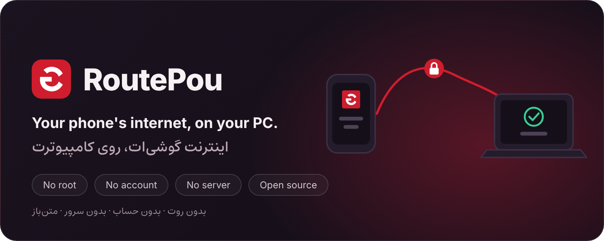

 

 

 
Website: <a href="https://routepou.pouone.ir">routepou.pouone.ir</a>

 

`0.27.0-beta`

RoutePou lets a Windows PC use the internet connection of an Android phone, including the VPN running on that phone. Put both on the same Wi-Fi, turn the phone's VPN on, press **Start sharing** on the phone and scan the QR code it shows with the Windows app. No hotspot, no root and no account are needed.

> **Beta.** The code builds in CI and has automated tests, but a real phone-to-PC connection has not been fully tested on hardware yet. The checklist is in [TESTING.md](TESTING.md).

## How it works

1. **Same network.** Connect the phone and the PC to the same Wi-Fi. If there is no shared Wi-Fi, turn on the phone's hotspot and join it from the PC. Turn on the VPN on the phone if you want traffic to go through it.
2. **Start sharing.** Open RoutePou on the phone and tap **Start sharing**. A QR code appears.
3. **Scan.** Open RoutePou on Windows and scan the QR code with the camera, or load a picture of it. The connection starts by itself.

The QR code is a password. Anyone who sees it can use your phone's connection.

## Two ways to connect

| Mode | What it does | Status |
|---|---|---|
| **Secure proxy** | Windows opens an HTTP and SOCKS5 proxy on `127.0.0.1` and sends the traffic to the phone over TLS. The phone has its own certificate and Windows accepts only that one. Apps that follow the Windows proxy settings use it. | Beta |
| **Full WireGuard tunnel** | Windows creates a virtual adapter and sends all traffic (TCP, UDP, DNS) through the phone. If the phone link drops, traffic stays blocked instead of leaking through the PC's own network. Needs Administrator rights. | Experimental |

## Limits, stated plainly

- The phone and the PC must be able to reach each other directly: one shared Wi-Fi, or the phone's hotspot. A phone on mobile data alone cannot be reached from another network, and a QR code carries information, not a connection. Using RoutePou across different networks needs a relay server, which this project does not include yet.
- Some routers have "client isolation" or "AP isolation" turned on, which stops devices on the same Wi-Fi from seeing each other. Turn it off, or use the phone's hotspot.
- If your VPN app has split tunneling, do not exclude RoutePou from the VPN.
- **iPhone:** Apple does not allow any app to share the phone's internet or VPN with a computer, so RoutePou does not run on iPhone.
- macOS and Linux are not supported yet.

## Website

[routepou.pouone.ir](https://routepou.pouone.ir) is the download page for Windows and Android. Its source (`index.html`, `site.css`, `site.js` and the font files) is in this repository and is published with GitHub Pages.

## Security

Each Android installation creates its own TLS key and certificate in the Android Keystore, and Windows pins the certificate fingerprint from the QR code. The full-tunnel QR expires after 5 minutes. Details and how to report a problem: [SECURITY.md](SECURITY.md).

## Build it yourself

Every file sits in the repository root. Pushing to GitHub runs three independent workflows in `.github/workflows/`: `tests.yml` (tests), `windows.yml` (builds and publishes the EXE) and `android.yml` (builds and publishes the APK). A green build puts its file on the Releases page by itself. Steps for maintainers: [PUBLISHING.md](PUBLISHING.md).

## License

GPL-3.0. Third-party components are listed in [THIRD_PARTY_NOTICES.md](THIRD_PARTY_NOTICES.md).
