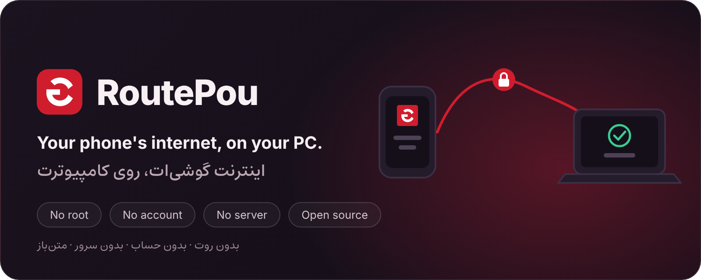

 

 

 
سایت: <a href="https://routepou.pouone.ir">routepou.pouone.ir</a>

 

`0.27.0-beta`

RoutePou اینترنت گوشی اندروید را، همراه با VPN روشن روی همان گوشی، به ویندوز می‌رساند. گوشی و کامپیوتر را به یک وای‌فای وصل کنید، VPN گوشی را روشن کنید، در گوشی «شروع اشتراک‌گذاری» را بزنید و QR را با برنامهٔ ویندوز اسکن کنید. نه هات‌اسپات لازم است، نه روت، نه حساب کاربری.

> **بتا:** کد در GitHub Actions ساخته و با تست خودکار بررسی می‌شود، ولی اتصال واقعی گوشی به کامپیوتر هنوز کامل روی سخت‌افزار آزمایش نشده است. فهرست آزمایش در [TESTING.md](TESTING.md) است.

## نصب

1. از صفحهٔ [Releases](https://github.com/farrokhzad743-dot/RoutePouNew/releases/latest) دو فایل را بگیرید:
   - `RoutePou-android.apk` را روی گوشی نصب کنید. اندروید ممکن است اجازهٔ «نصب از منبع ناشناس» بخواهد.
   - `RoutePou-windows-x64.exe` را روی ویندوز اجرا کنید. این فایل امضای دیجیتال ندارد؛ اگر SmartScreen هشدار داد، «More info» و بعد «Run anyway» را بزنید.
2. یا از سایت دانلود: [routepou.pouone.ir](https://routepou.pouone.ir)

## استفاده

1. گوشی و ویندوز را به **یک وای‌فای** وصل کنید. وای‌فای مشترک ندارید؟ هات‌اسپات گوشی را روشن کنید و ویندوز را به آن وصل کنید.
2. اگر می‌خواهید ترافیک از VPN بگذرد، VPN گوشی را روشن کنید.
3. در RoutePou اندروید «شروع اشتراک‌گذاری» را بزنید. یک QR نمایش داده می‌شود.
4. در RoutePou ویندوز «اسکن با دوربین» را بزنید و QR را نشان دهید، یا تصویر QR را انتخاب کنید. اتصال خودکار برقرار می‌شود.
5. برای اطمینان، آدرس IP خود را (مثلاً در یک سایت «what is my IP») یک بار پیش از اتصال و یک بار بعد از اتصال ببینید. اگر IP عوض شد، مسیر کار می‌کند.

QR مثل رمز عبور است؛ هر کس آن را ببیند می‌تواند از اینترنت گوشی شما استفاده کند. QR تونل کامل پس از ۵ دقیقه منقضی می‌شود.

هر دو برنامه دکمهٔ زبان دارند (فارسی / English) و انتخاب شما را برای دفعهٔ بعد نگه می‌دارند.

## دو حالت اتصال

| حالت | توضیح | وضعیت |
|---|---|---|
| **پروکسی امن** | ویندوز پروکسی HTTP و SOCKS5 روی `127.0.0.1` باز می‌کند و ترافیک را با TLS به گوشی می‌فرستد. گوشی گواهی مخصوص خودش را دارد و ویندوز فقط همان را می‌پذیرد. برنامه‌هایی که از پروکسی سیستم پیروی می‌کنند کار می‌کنند. | بتا |
| **تونل کامل WireGuard** | یک آداپتر مجازی ساخته می‌شود و همهٔ ترافیک (TCP، UDP و DNS) از گوشی می‌گذرد. اگر ارتباط گوشی قطع شود، ترافیک مسدود می‌ماند و از شبکهٔ خود کامپیوتر نشت نمی‌کند. به دسترسی Administrator نیاز دارد. این حالت در «تنظیمات پیشرفته» اندروید است. | آزمایشی |

## اگر وصل نشد

- **«به گوشی نرسیدم»:** مطمئن شوید هر دو دستگاه واقعاً به یک وای‌فای (یک روتر) وصل‌اند.
- **روتر «جداسازی کلاینت‌ها» یا AP isolation دارد:** این گزینه را در تنظیمات روتر خاموش کنید، یا از هات‌اسپات گوشی استفاده کنید.
- **فایروال ویندوز:** اگر پرسید، اجازهٔ شبکه به RoutePou بدهید.
- **VPN با Split tunneling:** RoutePou را از VPN مستثنی نکنید.
- **ذخیره‌سازی باتری:** برای RoutePou در اندروید «بدون محدودیت» را انتخاب کنید تا با خاموش‌شدن صفحه قطع نشود.
- **گواهی با QR نمی‌خواند:** در برنامهٔ اندروید «ساخت کلید جفت‌سازی جدید» را بزنید و QR تازه را اسکن کنید.

## محدودیت‌ها

- گوشی و ویندوز باید همدیگر را مستقیم ببینند: یک وای‌فای مشترک یا هات‌اسپات گوشی. گوشیِ فقط روی اینترنت موبایل از شبکهٔ دیگر در دسترس نیست و QR تنها اطلاعات می‌دهد، اتصال نمی‌سازد. اتصال از دو شبکهٔ جدا به یک سرور واسط نیاز دارد که فعلاً در RoutePou نیست.
- **آیفون:** اپل به هیچ برنامه‌ای اجازه نمی‌دهد اینترنت یا VPN گوشی را با کامپیوتر به اشتراک بگذارد؛ پس RoutePou روی آیفون اجرا نمی‌شود.
- macOS و لینوکس هنوز پشتیبانی نمی‌شوند.

## امنیت

هر نصب اندروید کلید و گواهی TLS مخصوص خودش را در Android Keystore می‌سازد و ویندوز اثر انگشت گواهی را از QR می‌گیرد و فقط همان را می‌پذیرد. جزئیات و راه گزارش مشکل: [SECURITY.md](SECURITY.md).

## وب‌سایت

[routepou.pouone.ir](https://routepou.pouone.ir) صفحهٔ دانلود ویندوز و اندروید است. سورس آن (`index.html`، `site.css`، `site.js` و فایل‌های فونت) در همین مخزن است و با GitHub Pages منتشر می‌شود.

## ساخت از روی سورس

همهٔ فایل‌ها در ریشهٔ مخزن‌اند. با هر Push سه workflow مستقل در `.github/workflows/` اجرا می‌شود: `tests.yml` (تست‌ها)، `windows.yml` (ساخت و انتشار EXE) و `android.yml` (ساخت و انتشار APK). ساخت موفق، فایلش را خودش در صفحهٔ Releases می‌گذارد. مراحل برای نگهدارنده: [PUBLISHING.md](PUBLISHING.md).

## لایسنس

GPL-3.0. اجزای شخص ثالث در [THIRD_PARTY_NOTICES.md](THIRD_PARTY_NOTICES.md) فهرست شده‌اند.

